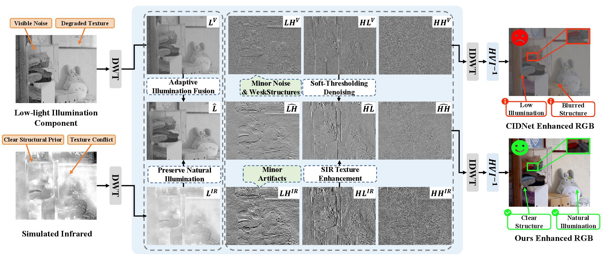
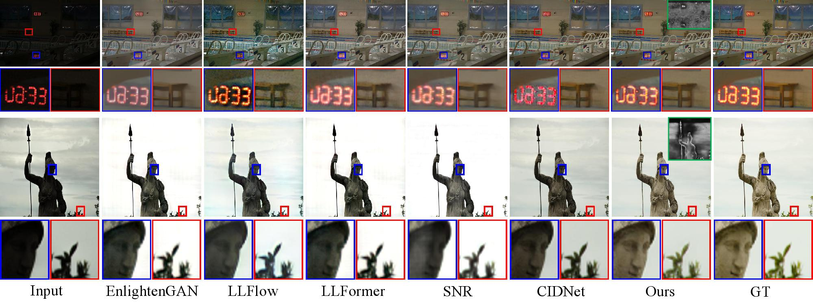

# SIR-HVINet: Simulated Infrared Guided HVI Color Space for Low-Light Image Enhancement

Official implementation of:

**SIR-HVINet: Simulated Infrared Guided HVI Color Space for Low-Light Image Enhancement**

📄 Paper: [Paper Link]

## Abstract

Low-light image enhancement (LLIE) aims to restore visibility while preserving structural details and color fidelity. 
Existing HVI-based approaches rely on fixed luminance modeling, which limits their adaptability under extremely low-light conditions.

In this work, we propose **SIR-HVINet**, a simulated infrared guided enhancement framework built upon the HVI color space. 
By introducing simulated infrared (SIR) images as an auxiliary luminance prior, our method provides complementary structural and illumination guidance for challenging low-light scenarios.

Specifically, we design a **Wavelet-based Infrared Fusion (WIF)** module to integrate SIR-derived luminance information into the intensity component through frequency-aware fusion. 
Furthermore, a **Dual-Path Cross-Contextual Attention (DPCCA)** mechanism is introduced to facilitate cross-component interaction between color and illumination representations.

Extensive experiments demonstrate that SIR-HVINet achieves superior performance compared with state-of-the-art methods on multiple low-light image enhancement benchmarks.

## Framework

<p align="center">

</p>

## Results

Our method achieves competitive performance on several benchmark datasets.

| Dataset | PSNR | SSIM | LPIPS |
|---------|------|------|-------|
| LOL-v1 | 28.834 | 0.890 | 0.038 |
| LOL-v2-Real | 24.486 | 0.880 | 0.104 |
| LOL-v2-Synthetic | 26.829 | 0.944 | 0.019 |

## Visualization

<p align="center">

</p>


## Code

The official implementation will be released soon.

Stay tuned!


## Citation

If you find this work useful, please cite:

```bibtex
@inproceedings{li2026sirhvinet,
  author    = {Li, Kaijiang and Hu, Ke and Xu, Hao
               and Zheng, Haokun and Xu, Yulu and Lv, Pei},
  title     = {SIR-HVINet: Simulated Infrared Guided HVI
               Color Space for Low-Light Image Enhancement},
  booktitle = {Proceedings of the 34th ACM International
               Conference on Multimedia},
  year      = {2026}
}
